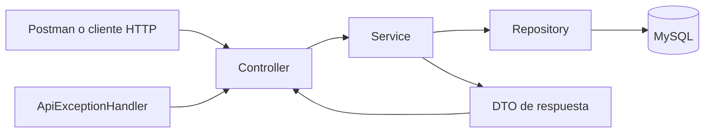
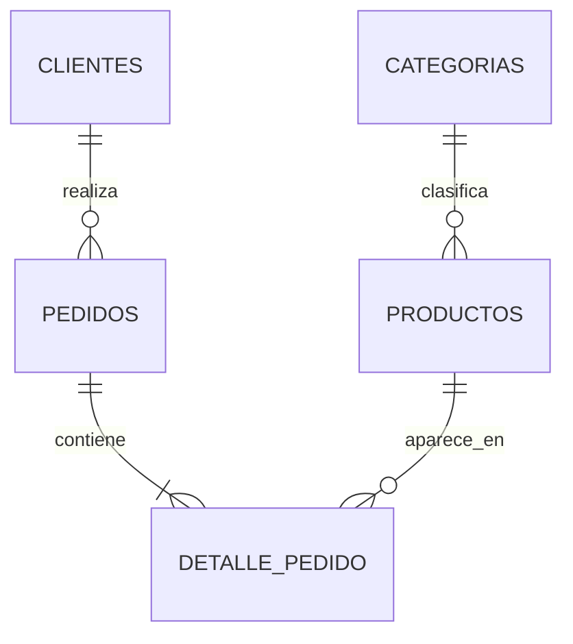

# Tienda API | Java y Spring Boot

Backend de una tienda desarrollado como proyecto de aprendizaje de Java, Spring Boot y persistencia relacional. Permite administrar categorías, productos y clientes, registrar pedidos, descontar existencias y cancelar compras devolviendo las unidades al inventario.

La aplicación expone una **API REST con respuestas JSON**. Se puede consumir desde Postman, otro cliente HTTP o una futura interfaz web. No incluye una tienda visual: abrir `/` en el navegador puede devolver 404 porque esa ruta no está implementada.

> **Estado actual:** el proyecto compila y dispone de un JAR ejecutable. Los reportes locales revisados registran 7 pruebas correctas. Existe una incidencia identificada en el cálculo de pedidos con varios productos; revisa [Incidencia conocida](#incidencia-conocida) antes de utilizar ese flujo.

## Índice

- [Funcionalidades y alcance](#funcionalidades-y-alcance)
- [Tecnologías y requisitos](#tecnologías-y-requisitos)
- [Arquitectura](#arquitectura)
- [Modelo de datos](#modelo-de-datos)
- [Instalación y configuración](#instalación-y-configuración)
- [Ejecución](#ejecución)
- [Contrato de la API](#contrato-de-la-api)
- [Ejemplo completo con Postman](#ejemplo-completo-con-postman)
- [Reglas de negocio](#reglas-de-negocio)
- [Errores HTTP](#errores-http)
- [Pruebas](#pruebas)
- [Solución de problemas](#solución-de-problemas)
- [Límites y siguientes mejoras](#límites-y-siguientes-mejoras)

## Funcionalidades y alcance

| Módulo | Operaciones implementadas |
|---|---|
| Categorías | Crear, listar, editar y eliminar si no tienen productos asociados. |
| Productos | Crear, consultar por ID, buscar por nombre, paginar, editar y desactivar. |
| Clientes | Registrar, consultar por ID y actualizar. |
| Pedidos | Crear con detalles, consultar por ID y cancelar. |
| Inventario | Descontar al comprar y reponer al cancelar. |
| Validación | Rechazar campos inválidos, productos inactivos, duplicados y stock insuficiente. |

No se implementan pagos, envíos, impuestos, autenticación, roles, reactivación de productos ni una interfaz gráfica. Un pedido `CREADO` representa una operación registrada, no un pago confirmado.

Los ejemplos interpretan los importes en soles (PEN). El modelo no almacena un código de moneda ni admite conversión entre monedas.

## Tecnologías y requisitos

| Componente | Configuración del proyecto | Función |
|---|---|---|
| Java | JDK 25 | Compilación y ejecución. |
| Spring Boot | 4.0.8 | Arranque y configuración de componentes. |
| Spring Web MVC | `spring-boot-starter-webmvc` | Endpoints REST y Tomcat integrado. |
| Spring Data JPA / Hibernate | `spring-boot-starter-data-jpa` | Persistencia y relaciones entre entidades. |
| Bean Validation | `spring-boot-starter-validation` | Validación de solicitudes HTTP. |
| MySQL | Probado manualmente con Server 8.4.13 | Base persistente de la aplicación. |
| MySQL Connector/J | `mysql-connector-j`, scope `runtime` | Controlador JDBC de MySQL. |
| Lombok | Versión administrada por Spring Boot | Getters, setters y constructores. |
| Maven Wrapper | Distribución configurada: Maven 3.10.0 | Construcción reproducible sin instalar Maven aparte. |
| Spring Boot Test / JUnit Jupiter | Scope `test` | Pruebas automatizadas. |
| H2 | Scope `test` | Base temporal de pruebas. |

Herramientas opcionales: IntelliJ IDEA para desarrollar, MySQL Workbench para administrar la base y Postman para probar la API. **No hace falta instalar Tomcat por separado.**

Antes de empezar:

```powershell
java -version
.\mvnw.cmd -version
```

Ejecuta el segundo comando desde la raíz del proyecto. El JDK utilizado debe ser 25. La primera ejecución del wrapper y la descarga inicial de dependencias requieren acceso a internet.

## Arquitectura



| Capa | Responsabilidad | Ejemplo |
|---|---|---|
| `controller` | Recibir HTTP, validar entrada y delegar operaciones. | `PedidoController` |
| `service` | Aplicar reglas de negocio y delimitar transacciones. | `PedidoService` |
| `repository` | Consultar y guardar entidades mediante JPA. | `ProductoRepository` |
| `entity` | Representar tablas, relaciones y versiones. | `Producto`, `Pedido` |
| `dto` | Definir los datos de entrada y salida con records. | `Dtos.PedidoInput` |
| `exception` | Convertir errores en respuestas HTTP. | `ApiExceptionHandler` |

La inyección de dependencias se realiza mediante constructores generados por `@RequiredArgsConstructor` para los campos `final`. Los controladores no acceden directamente a MySQL ni calculan importes.

### Estructura

```text
tienda/
├── .mvn/wrapper/maven-wrapper.properties
├── mvnw
├── mvnw.cmd
├── pom.xml
├── src/main/java/com/ejemplo/tienda/
│   ├── TiendaApplication.java
│   ├── controller/
│   │   ├── CatalogoController.java
│   │   └── PedidoController.java
│   ├── dto/Dtos.java
│   ├── entity/
│   │   ├── Categoria.java
│   │   ├── Producto.java
│   │   ├── Cliente.java
│   │   ├── Pedido.java
│   │   ├── DetallePedido.java
│   │   └── EstadoPedido.java
│   ├── repository/
│   │   ├── CategoriaRepository.java
│   │   ├── ProductoRepository.java
│   │   ├── ClienteRepository.java
│   │   └── PedidoRepository.java
│   ├── service/
│   │   ├── CatalogoService.java
│   │   └── PedidoService.java
│   └── exception/
│       ├── Errores.java
│       └── ApiExceptionHandler.java
├── src/main/resources/application.properties
├── src/test/java/com/ejemplo/tienda/
│   ├── PedidoServiceTest.java
│   └── TiendaApplicationTests.java
└── src/test/resources/application-test.properties
```

`target/` se genera al compilar: contiene clases, reportes de pruebas y el JAR. No es una carpeta de código fuente.

## Modelo de datos



| Tabla | Datos principales |
|---|---|
| `categorias` | ID y nombre único. |
| `productos` | Nombre, precio, stock, activo, categoría y versión. |
| `clientes` | Nombre, email único y dirección. |
| `pedidos` | Cliente, fecha, estado, total y versión. |
| `detalle_pedido` | Pedido, producto, cantidad y precio unitario histórico. |

- Los IDs son `Long` generados por la base de datos. No deben asumirse consecutivos ni empezar siempre en 1.
- Los precios se representan con `BigDecimal` y columnas decimales: precio unitario `DECIMAL(12,2)` y total `DECIMAL(19,2)`.
- El precio del detalle se copia al crear el pedido; una modificación posterior del catálogo no cambia el importe histórico del detalle.
- La fecha se representa con `Instant`; las respuestas expresan el instante en UTC.
- Los estados disponibles son `CREADO` y `CANCELADO`.
- El pedido guarda sus detalles por cascada. No existe un repositorio público ni un endpoint independiente para detalles.

## Instalación y configuración

### 1. Abrir el proyecto

Descarga o clona el repositorio y abre en IntelliJ la carpeta que contiene `pom.xml`. Importa como proyecto Maven y espera a que se descarguen las dependencias.

En IntelliJ configura:

1. **Project Structure → Project SDK:** JDK 25.
2. **Settings → Build Tools → Maven → Importing:** Project JDK 25.
3. **Settings → Build Tools → Maven → Runner:** Project JDK 25.
4. **Compiler → Annotation Processors:** habilitar annotation processing si Lombok no se reconoce.

El `pom.xml` también configura el procesador de Lombok para la compilación con Maven. `${lombok.version}` se hereda de Spring Boot.

### 2. Preparar MySQL

Instala MySQL Server y asegúrate de que esté iniciado en `localhost:3306`. Workbench es un cliente de administración; no sustituye al servidor.

Conéctate como administrador y ejecuta una sola vez, **reemplazando primero la contraseña de ejemplo**:

```sql
CREATE DATABASE tienda_db
  CHARACTER SET utf8mb4
  COLLATE utf8mb4_unicode_ci;

CREATE USER 'tienda_app'@'localhost'
  IDENTIFIED BY 'REEMPLAZAR_POR_UNA_CLAVE_LOCAL';

GRANT ALL PRIVILEGES ON tienda_db.*
  TO 'tienda_app'@'localhost';
```

Los permisos se limitan a `tienda_db`; incluyen cambios de estructura para que Hibernate pueda crear y actualizar tablas durante el desarrollo.

Si la cuenta ya existe, no repitas `CREATE USER`. Para cambiar su contraseña:

```sql
ALTER USER 'tienda_app'@'localhost'
  IDENTIFIED BY 'REEMPLAZAR_POR_LA_NUEVA_CLAVE';
```

Comprueba la base:

```sql
SHOW DATABASES LIKE 'tienda_db';
```

No hay datos iniciales automáticos en MySQL. Las categorías, productos y clientes se registran por la API. Hibernate crea las tablas al iniciar la aplicación.

### 3. Configuración de la aplicación

Archivo: `src/main/resources/application.properties`.

```properties
spring.application.name=tienda
server.port=8080

spring.datasource.url=jdbc:mysql://localhost:3306/tienda_db
spring.datasource.username=${DB_USER:tienda_app}
spring.datasource.password=${DB_PASSWORD}

spring.jpa.hibernate.ddl-auto=update
spring.jpa.open-in-view=false
spring.jpa.show-sql=true
```

| Propiedad | Explicación |
|---|---|
| `server.port` | Puerto HTTP de la API, independiente del puerto MySQL. |
| `spring.datasource.url` | Servidor, puerto y base a los que se conecta JDBC. |
| `DB_USER` | Usuario MySQL; si no se define, usa `tienda_app`. |
| `DB_PASSWORD` | Contraseña del usuario MySQL. Debe proporcionarse externamente. |
| `ddl-auto=update` | Ajusta el esquema durante desarrollo; no borra la base al cerrar. |
| `open-in-view=false` | Las relaciones necesarias para la respuesta se leen dentro del servicio. |
| `show-sql=true` | Muestra consultas SQL en la consola para facilitar el aprendizaje. |

No reemplaces `${DB_PASSWORD}` por una contraseña real en un archivo que vaya a compartirse. Tampoco publiques capturas, archivos de ejecución o exportaciones con credenciales.

### 4. Configuración del perfil de pruebas

Archivo: `src/test/resources/application-test.properties`.

```properties
spring.datasource.url=jdbc:h2:mem:tienda_test;DB_CLOSE_DELAY=-1
spring.datasource.driver-class-name=org.h2.Driver
spring.datasource.username=sa
spring.datasource.password=
spring.jpa.hibernate.ddl-auto=create-drop
spring.jpa.show-sql=false
```

Las dos clases de pruebas declaran `@ActiveProfiles("test")`. Utilizan una base H2 en memoria y no requieren credenciales de MySQL. El usuario `sa` y la contraseña vacía pertenecen exclusivamente a esa base temporal.

Este archivo vive en los recursos de pruebas y no se incluye como configuración normal del JAR. No actives el perfil `test` como forma de ejecutar la tienda en producción.

## Ejecución

Todos los comandos se ejecutan en la carpeta que contiene `pom.xml`.

### Opción A: IntelliJ IDEA

En **Run → Edit Configurations → TiendaApplication → Modify options → Environment variables**, configura:

| Variable | Valor |
|---|---|
| `DB_USER` | `tienda_app` |
| `DB_PASSWORD` | Tu contraseña de `tienda_app`, sin comillas. |

Deja **Active profiles** vacío y ejecuta `TiendaApplication`. Las variables de esta configuración no se trasladan automáticamente a la terminal de IntelliJ.

### Opción B: Maven Wrapper en Windows PowerShell

Configura las variables en la misma terminal donde ejecutarás la aplicación:

```powershell
$env:DB_USER = 'tienda_app'
$claveTienda = Read-Host 'Contraseña de tienda_app' -AsSecureString
$env:DB_PASSWORD = [System.Net.NetworkCredential]::new('', $claveTienda).Password
.\mvnw.cmd spring-boot:run
```

Ejecuta las líneas en orden. La segunda solicita la contraseña de forma interactiva; escríbela cuando aparezca el mensaje y pulsa Enter. No se sustituye el texto del comando por la contraseña.

### Opción C: empaquetar y ejecutar el JAR

```powershell
.\mvnw.cmd clean package
```

Maven compila, ejecuta las pruebas y genera:

```text
target/tienda-0.0.1-SNAPSHOT.jar
```

Después de configurar `DB_USER` y `DB_PASSWORD` como en la opción B:

```powershell
java -jar .\target\tienda-0.0.1-SNAPSHOT.jar
```

Usa `.jar`, no `.jar.original`. El JAR ejecutable incluye las dependencias y el servidor web. Para ejecutarlo necesitas Java y acceso a MySQL, pero no IntelliJ ni Maven.

En Linux/macOS, el comando de construcción equivalente es `./mvnw clean package`; proporciona las mismas variables mediante el mecanismo de tu shell o entorno.

### Comprobar el arranque

Busca `Started TiendaApplication` y Tomcat escuchando en `8080`. Luego consulta:

```http
GET http://localhost:8080/api/categorias
```

Una base nueva devuelve `200 OK` con `[]`. Los datos creados anteriormente permanecen en MySQL aunque reinicies la aplicación o cambies de ejecución por IDE a JAR.

No ejecutes dos instancias en el mismo puerto. Detén la anterior antes de arrancar otra. Para detener el JAR en la terminal, utiliza **Ctrl + C**. Si modificas código después de empaquetar, vuelve a construir el JAR para incluir los cambios.

## Contrato de la API

Base local: `http://localhost:8080`. Las solicitudes con cuerpo usan `Content-Type: application/json`. GET, DELETE y la cancelación no requieren Body.

| Método | Ruta | Operación | Éxito |
|---|---|---|---|
| GET | `/api/categorias` | Listar categorías ordenadas por ID. | 200 |
| POST | `/api/categorias` | Crear categoría. | 201 |
| PUT | `/api/categorias/{id}` | Actualizar nombre. | 200 |
| DELETE | `/api/categorias/{id}` | Borrar categoría sin productos. | 204 |
| GET | `/api/productos` | Buscar y paginar productos activos. | 200 |
| GET | `/api/productos/{id}` | Consultar un producto, incluso inactivo. | 200 |
| POST | `/api/productos` | Crear producto activo. | 201 |
| PUT | `/api/productos/{id}` | Editar nombre, precio, stock y categoría. | 200 |
| DELETE | `/api/productos/{id}` | Desactivar producto. | 204 |
| POST | `/api/clientes` | Registrar cliente. | 201 |
| GET | `/api/clientes/{id}` | Consultar cliente. | 200 |
| PUT | `/api/clientes/{id}` | Actualizar nombre, email y dirección. | 200 |
| POST | `/api/pedidos` | Registrar compra y descontar stock. | 201 |
| GET | `/api/pedidos/{id}` | Consultar pedido con detalles. | 200 |
| PATCH | `/api/pedidos/{id}/cancelacion` | Cancelar y reponer stock. | 200 |

No hay GET de categoría individual, listado general de clientes o pedidos, DELETE de pedidos ni DELETE de clientes. El nombre de una solicitud de Postman no define su comportamiento: lo determinan el método y la URL.

### Validaciones de entrada

| DTO/campo | Restricción |
|---|---|
| Categoría: `nombre` | Obligatorio, no vacío, máximo 80 caracteres. |
| Producto: `nombre` | Obligatorio, no vacío, máximo 100 caracteres. |
| Producto: `precio` | Obligatorio, mínimo 0.01, hasta 10 dígitos enteros y 2 decimales. |
| Producto: `stock` | Obligatorio, entre 0 y 1 000 000. |
| Producto: `categoriaId` | Obligatorio, positivo; debe existir. |
| Cliente: `nombre` | Obligatorio, no vacío, máximo 100 caracteres. |
| Cliente: `email` | Obligatorio, formato de email, máximo 150 caracteres; único. |
| Cliente: `direccion` | Obligatoria, no vacía, máximo 200 caracteres. |
| Pedido: `clienteId` | Obligatorio, positivo; debe existir. |
| Pedido: `items` | Entre 1 y 50 elementos, sin elementos nulos. |
| Detalle: `productoId` | Obligatorio, positivo; debe existir y estar activo. |
| Detalle: `cantidad` | Obligatoria, entre 1 y 1000. |

Los PUT reciben todos los campos del DTO de entrada, no una actualización parcial. En producto, `stock` es el valor absoluto que quedará registrado, no una cantidad para sumar. PUT no reactiva productos.

### Búsqueda y paginación

```http
GET /api/productos?nombre=silla&pagina=0&tamano=10
```

- `nombre`: texto contenido en el nombre, sin distinguir mayúsculas; por defecto vacío.
- `pagina`: comienza en 0; por defecto 0.
- `tamano`: entre 1 y 100; por defecto 10.
- Solo se listan productos activos, ordenados por ID. Un producto activo puede tener stock 0.

Ejemplo ilustrativo de respuesta:

```json
{
  "contenido": [
    {
      "id": 20,
      "nombre": "Silla de oficina",
      "precio": 250.00,
      "stock": 10,
      "activo": true,
      "categoriaId": 10
    }
  ],
  "pagina": 0,
  "tamano": 10,
  "totalElementos": 1,
  "totalPaginas": 1
}
```

## Ejemplo completo con Postman

### Preparar variables

Crea una colección `Tienda` y un **Environment `Tienda`**. Selecciona ese Environment antes de enviar solicitudes. Este README utiliza variables de entorno de Postman de forma consistente.

| Variable | Valor inicial |
|---|---|
| `baseUrl` | `http://localhost:8080` |
| `categoriaId` | Vacío |
| `productoId` | Vacío |
| `clienteId` | Vacío |
| `pedidoId` | Vacío |

No dupliques los mismos nombres en colección y Environment: el Environment tiene prioridad y puede ocultar un valor de colección. Las variables de Postman son distintas de las variables del proceso Java: no pongas aquí la contraseña de MySQL.

Guardar una solicitud no crea datos. **Send** envía la petición. Ejecuta los POST en el orden siguiente y continúa solo tras recibir 201. No reenvíes pedidos exitosos solo para recuperar el ID: crearías otra compra.

### 1. Crear categoría

```http
POST {{baseUrl}}/api/categorias
```

Body → raw → JSON:

```json
{
  "nombre": "Oficina"
}
```

Scripts → After response:

```javascript
pm.test("Categoría creada", () => pm.response.to.have.status(201));
if (pm.response.code === 201) {
    pm.environment.set("categoriaId", pm.response.json().id);
}
```

Si `Oficina` ya existe, consulta GET `/api/categorias` y guarda manualmente su ID en el Environment, o utiliza un nombre nuevo. Un 409 por duplicado no guarda un nuevo ID.

### 2. Crear producto

```http
POST {{baseUrl}}/api/productos
```

Body de Postman (las variables numéricas se sustituyen antes de enviar):

```text
{
  "nombre": "Silla de oficina",
  "precio": 250.00,
  "stock": 10,
  "categoriaId": {{categoriaId}}
}
```

After response:

```javascript
if (pm.response.code === 201) {
    pm.environment.set("productoId", pm.response.json().id);
}
```

Selecciona JSON en Postman aunque el ejemplo anterior se muestre como plantilla de texto. Fuera de Postman, reemplaza `{{categoriaId}}` por el número real para obtener JSON válido. No agregues comillas al ID.

### 3. Crear cliente

```http
POST {{baseUrl}}/api/clientes
```

```json
{
  "nombre": "Ana Torres",
  "email": "ana.oficina@example.com",
  "direccion": "Av. Primavera 123, Lima"
}
```

After response:

```javascript
if (pm.response.code === 201) {
    pm.environment.set("clienteId", pm.response.json().id);
}
```

Usa un email no registrado. El servicio normaliza el correo a minúsculas y elimina espacios exteriores.

### 4. Comprar dos unidades

```http
POST {{baseUrl}}/api/pedidos
```

```text
{
  "clienteId": {{clienteId}},
  "items": [
    {
      "productoId": {{productoId}},
      "cantidad": 2
    }
  ]
}
```

After response:

```javascript
pm.test("Pedido creado", () => pm.response.to.have.status(201));
if (pm.response.code === 201) {
    const pedido = pm.response.json();
    pm.environment.set("pedidoId", pedido.id);
    pm.test("Total y estado correctos", () => {
        pm.expect(pedido.total).to.eql(500);
        pm.expect(pedido.estado).to.eql("CREADO");
    });
}
```

Respuesta ilustrativa; los IDs y la fecha reales serán diferentes:

```json
{
  "id": 40,
  "clienteId": 30,
  "fecha": "2026-10-21T18:00:00Z",
  "estado": "CREADO",
  "total": 500.00,
  "items": [
    {
      "productoId": 20,
      "cantidad": 2,
      "precioUnitario": 250.00,
      "subtotal": 500.00
    }
  ]
}
```

Comprueba el inventario con GET `{{baseUrl}}/api/productos/{{productoId}}`: debe quedar stock 8 si no hubo otras operaciones. Consulta el pedido con GET `{{baseUrl}}/api/pedidos/{{pedidoId}}`.

### 5. Cancelar y verificar

```http
PATCH {{baseUrl}}/api/pedidos/{{pedidoId}}/cancelacion
```

Body → none. Debe devolver 200 y `estado: CANCELADO`. El producto vuelve a stock 10. Repetir la cancelación devuelve 409 y no vuelve a sumar unidades.

### 6. Actualizar y desactivar

- PUT `/api/categorias/{{categoriaId}}`: envía `{"nombre":"Muebles de oficina"}`.
- PUT `/api/productos/{{productoId}}`: envía los cuatro campos de creación del producto con los valores que quieras dejar registrados.
- PUT `/api/clientes/{{clienteId}}`: envía nombre, email y dirección.
- DELETE `/api/productos/{{productoId}}`: devuelve 204 y deja `activo=false`; conserva el historial.
- DELETE `/api/categorias/{{categoriaId}}`: devuelve 409 si hay productos asociados, incluso si están inactivos.

Haz la desactivación al final de las pruebas de compra. No existe una operación de reactivación en esta versión.

## Reglas de negocio

### Transacciones y rollback

Crear un pedido y descontar su inventario forman una transacción. Si falta un producto, no alcanza el stock o se repite un ID, se revierte la operación completa. Los cambios pendientes de las entidades gestionadas se escriben al confirmar la transacción.

La cancelación también es transaccional: repone las cantidades y cambia el estado a `CANCELADO`. Una segunda cancelación se rechaza. El total y los detalles históricos se conservan.

### Control de concurrencia

`Producto` y `Pedido` tienen `@Version`. Hibernate utiliza la versión para detectar modificaciones concurrentes de la misma entidad. Un conflicto de bloqueo optimista se traduce a HTTP 409 y revierte la transacción.

Esto no equivale a una prueba de concurrencia realizada. Enviar dos solicitudes consecutivas y obtener 201 seguido de 409 por stock insuficiente solo verifica el stock agotado. Para validar una carrera real se requieren transacciones coordinadas contra MySQL.

El DTO de actualización no incluye versión. Por tanto, el control actual no detecta automáticamente toda edición basada en una pantalla antigua cuando las operaciones ya no se solapan.

### Integridad y validación

- El email del cliente y el nombre de categoría tienen restricciones únicas en la base.
- Una categoría relacionada con productos no puede eliminarse por la clave foránea.
- El listado de productos excluye inactivos; la consulta individual permite inspeccionarlos.
- El cliente no proporciona el total ni el precio de compra en `PedidoInput`.
- El detalle conserva el precio leído del catálogo al crear el pedido.
- La validación de DTO se activa mediante `@Valid` en HTTP. No debe asumirse que llamadas directas al servicio ejecutan esas mismas validaciones automáticamente.

## Errores HTTP

`ApiExceptionHandler` centraliza errores con `ProblemDetail`.

| Código | Significado y ejemplos |
|---|---|
| 400 | Campos inválidos, JSON incorrecto, parámetros fuera de rango o ID no numérico. |
| 404 | Categoría, cliente, producto o pedido inexistente. |
| 409 | Duplicado, categoría con productos, stock insuficiente, producto inactivo, cancelación repetida o conflicto optimista. |

Ejemplo de error de negocio; otros campos pueden acompañarlo:

```json
{
  "title": "Conflict",
  "status": 409,
  "detail": "Stock insuficiente: Silla de oficina",
  "instance": "/api/pedidos"
}
```

Los errores de validación pueden incluir una lista `errores` con los campos afectados. Un 409 no siempre significa stock insuficiente: lee `detail` para distinguir la causa.

## Pruebas

### Automatizadas

```powershell
.\mvnw.cmd test
```

Para ejecutar únicamente las pruebas de pedidos:

```powershell
.\mvnw.cmd '-Dtest=PedidoServiceTest' test
```

Reportes: `target/surefire-reports/`. Los reportes locales revisados al preparar este README registran **7 pruebas, 0 fallos, 0 errores y 0 omitidas**:

| Clase | Caso |
|---|---|
| `TiendaApplicationTests` | Carga del contexto con perfil test. |
| `PedidoServiceTest` | Cálculo del total de un producto y descuento de stock. |
| `PedidoServiceTest` | Rechazo de stock insuficiente. |
| `PedidoServiceTest` | Rollback si falla un segundo detalle. |
| `PedidoServiceTest` | Cancelación que repone inventario una sola vez. |
| `PedidoServiceTest` | Rechazo de productos inactivos. |
| `PedidoServiceTest` | Rechazo de productos repetidos y rollback. |
| `PedidoServiceTest` | Cálculo correcto del total y descuento de stock en un pedido con múltiples productos. |

Son pruebas con contexto Spring y persistencia H2. No constituyen cobertura completa de endpoints, serialización, restricciones específicas de MySQL ni concurrencia. Tampoco comprueban un pedido exitoso con varios productos, lo que explica la incidencia siguiente.

### Casos manuales recomendados

| Solicitud | Resultado esperado |
|---|---|
| Precio negativo o stock negativo | 400. |
| Email ya registrado | 409. |
| Pedido sin detalles o cantidad 0 | 400. |
| Producto inexistente después de un detalle válido | 404; stock del primero sin cambios. |
| Producto repetido en dos detalles | 409; sin cambios de inventario. |
| Cantidad superior al stock | 409; sin pedido confirmado. |
| GET productos con `tamano=0` | 400. |
| DELETE categoría con productos | 409. |
| Comprar producto inactivo | 409. |
| Cancelar dos veces | 200 y luego 409; reposición única. |

Al probar fallos, no utilices scripts que exijan 201 en todas las respuestas. Duplica las solicitudes de prueba y asigna la expectativa adecuada.

## Solución de problemas

| Problema | Qué revisar |
|---|---|
| `invalid target release: 25` | JDK del proyecto, JAVA_HOME y JDK usado por Maven. |
| Dependencias/imports en rojo | Recargar Maven y comprobar conectividad con Maven Central. |
| Lombok no genera métodos | Annotation processing y configuración de `maven-compiler-plugin`. |
| Falta `DB_PASSWORD` | Definirla en el proceso que arranca Java: configuración del IDE o terminal actual. |
| `Access denied for user` | Usuario y contraseña de `tienda_app`, permisos y host de la cuenta. |
| `Communications link failure` | MySQL iniciado, puerto 3306 y URL JDBC. |
| `Unknown database tienda_db` | Crear la base en el servidor correcto. |
| Puerto 8080 ocupado | Detener la otra instancia o cambiar `server.port` y `baseUrl`. |
| 404 al abrir `/` | Utilizar una ruta implementada, por ejemplo `/api/categorias`. |
| 409 al crear categoría | El nombre puede existir; consultar el listado antes de repetir POST. |
| GET devuelve lo mismo con Body | Los GET implementados no leen el cuerpo; usar Body → none. |
| IDs vacíos en Postman | Environment seleccionado, script `pm.environment.set` y respuesta 201. |
| `categoriaId` vale `null` | Consultar categorías y recuperar un ID real; no asumir que es 1. |
| `TiendaApplicationTests.contextLoads` falla | Comprobar `@ActiveProfiles("test")` y recursos de pruebas. |
| JAR no refleja cambios de código | Ejecutar de nuevo `clean package` y reiniciar el JAR. |

Si el contexto no inicia, busca la primera causa relevante en las líneas `Caused by:`. `BUILD FAILURE` es el resumen, no la causa específica.

## Límites y siguientes mejoras

Esta versión está orientada al aprendizaje y al uso local. Antes de publicarla para usuarios reales se requiere ampliar su diseño:

1. Incorporar autenticación, autorización y asociación del pedido con el cliente autenticado.
2. Sustituir `ddl-auto=update` por migraciones versionadas y validación del esquema.
3. Registrar movimientos y responsables de los ajustes de inventario.
4. Añadir claves de idempotencia para no duplicar compras ante reintentos.
5. Probar transacciones simultáneas con MySQL, por ejemplo mediante Testcontainers.
6. Añadir pruebas HTTP y documentación OpenAPI; actualmente no se incluye Swagger UI.
7. Definir una política de reactivación de productos y de cambios de estado de pedidos.
8. Añadir un frontend y la configuración CORS que requiera su origen; no existe una configuración CORS específica en esta versión.
9. Preparar gestión de secretos, HTTPS, observabilidad, copias de seguridad y permisos de base apropiados al despliegue.

No hay un archivo de licencia definido como parte de este README. El responsable del repositorio debe elegirlo antes de distribuir el proyecto con condiciones de reutilización específicas.

## Referencias

- [Spring Boot](https://docs.spring.io/spring-boot/4.0/)
- [Spring Data JPA](https://docs.spring.io/spring-data/jpa/reference/)
- [MySQL 8.4](https://dev.mysql.com/doc/refman/8.4/en/)
- [Postman Learning Center](https://learning.postman.com/)

Documentación preparada a partir del `pom.xml`, código fuente, configuración y reportes de pruebas locales del proyecto. Los ejemplos utilizan datos ficticios y no contienen credenciales reales.
